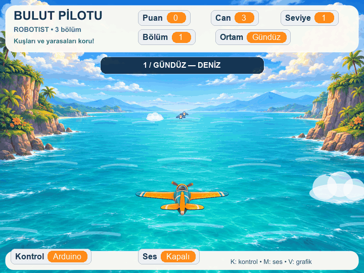
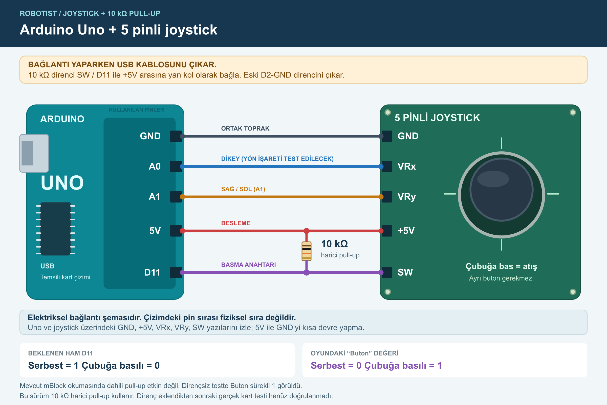
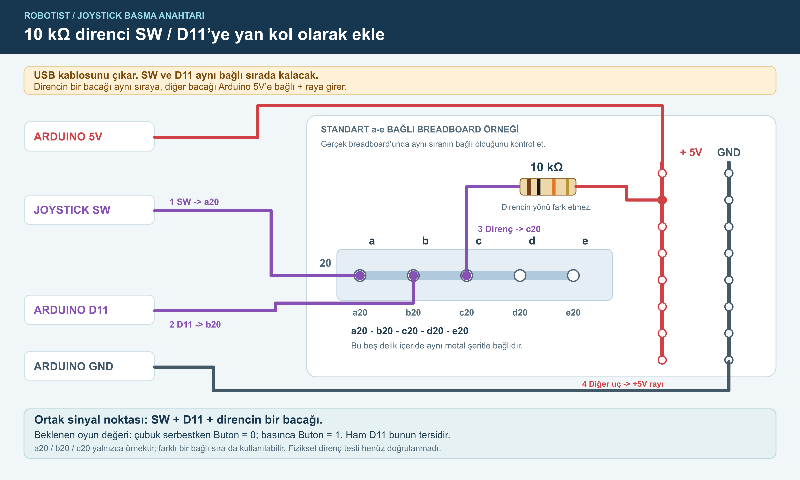

# 48 · Bulut Pilotu — Joystick ile Uçak Oyunu

**[Öğrenci paketini indir (ZIP)](Bulut_Pilotu_Ogrenci_Paketi.zip?raw=true)**

Arduino Uno ve 5 pinli joystick ile mBlock'ta üç bölümlü bir uçak oyunu. Joystick uçuşu, çubuğa basmak atışı yönetir. Oyun bilgisayarda çalışır; Arduino USB üzerinden kumanda sağlar. Kart olmadan klavyeyle de oynanabilir.

Önizleme sessizdir; üç ortamı 21 saniyede göstermek için bölüm geçişleri hızlandırılmıştır.

## Gerekli malzemeler

- Arduino Uno ve USB **veri** kablosu
- GND, +5V, VRx, VRy, SW uçları bulunan joystick modülü
- 10 kΩ direnç, breadboard ve jumper kablolar
- Windows veya Mac bilgisayar; mBlock 5 PC

Ayrı buton gerekmez; joystick'in basma anahtarı kullanılır.

## 1. İndir ve kur

1. ZIP dosyasını indirip bir klasöre **ayıklayın**. Projeyi ZIP içinden çalıştırmayın.
2. [Resmi mBlock indirme sayfasından](https://mblock.cc/pages/downloads) **mBlock PC** sürümünü kurun. Windows 64 bit, Mac ve Apple M1/M2 seçenekleri bulunur. Kontrol edilen sürüm 5.6.0'dır; kurucu öğrenci paketine dahil değildir.
3. İlk açılışta internet gerekebilir. Projedeki resmi **Arduino Uno** aygıtı ve **Data Chart** uzantısının yüklenmesini bekleyin; eksikse öğretmeninizle ekleyin.

Kurulum desteği: [Makeblock — Windows ve macOS kurulumu](https://support.makeblock.com/hc/en-us/articles/14779090584599-Install-mBlock-5-on-Windows-and-macOS).

ZIP içindeki `BASLA_BURADAN.html` dosyasını tarayıcıda açarak görselli rehberi çevrimdışı okuyabilirsiniz. [HTML rehberi](BASLA_BURADAN.html) · [Düz metin rehberi](BASLA_BURADAN.txt)

## 2. Devreyi bağla

**Bağlantı yaparken veya değiştirirken USB kablosunu çıkarın.** Modül üzerindeki pin yazılarını izleyin; fiziksel pin sırası modele göre değişebilir.

| Joystick / parça | Arduino Uno bağlantısı |
| --- | --- |
| GND | GND |
| +5V | 5V |
| VRx | A0 |
| VRy | A1 |
| SW | D11 |
| 10 kΩ direnç | SW/D11 ortak noktası ile 5V arasına |

Direnç **SW–D11 arasına seri konmaz**. SW–D11 kablosu yerinde kalır; direnç ortak noktadan 5V'ye bir yan kol oluşturur. Bu mBlock okumasında dahili pull-up etkin değildir; 10 kΩ harici pull-up kullanılır.

Standart breadboard örneği: SW → **a20**, D11 → **b20**, direncin bir bacağı → **c20**; diğer bacağı Uno 5V'ye bağlı **+ rayına**. a20–e20 aynı metal şerittir. Breadboard'unuzu kontrol edin; başka bir ortak sıra da kullanılabilir.

## 3. Önce joystick'i test et

1. mBlock'ta **Dosya → Aç** ile [Joystick_Test.mblock](Joystick_Test.mblock?raw=true) dosyasını açın.
2. Uno'yu USB veri kablosuyla bağlayın. Arduino Uno aygıtında **Canlı / Live** modunu seçin.
3. **Bağlan → Tüm bağlanabilen aygıtları göster** seçeneğinden Arduino'nun COM / usbserial portunu seçin. **“Aygıt bağlandı”** durumunu doğrulayın.
4. Joystick'i ortada bırakıp **yeşil bayrağa** basın.

Ekrandaki mavi nokta joystick ile hareket eder. `PotX` ham A0, `PotY` ham A1 değeridir: merkez yaklaşık **512**, hareket aralığı **0–1023**. `Buton` bırakılmışken **0**, çubuğa basınca **1**, bırakınca yeniden **0** olmalıdır; SERBEST/BASILI göstergesi de değişir. Ham D11 seviyesi bunun tersidir.

Pin/jumper uçları aşağı bakarken sağ itişte A1 artar. Oyunda **A1 sağ-sol**, **A0 yukarı-aşağı** hareketi yönetir. Yön tersse öğretmeninize bildirin; 5V ve GND'yi yer değiştirmeyin.

## 4. Oyunu başlat

**Dosya → Aç** ile [Bulut_Pilotu.mblock](Bulut_Pilotu.mblock?raw=true) dosyasını açın. Yeni proje açıldığında **yeniden bağlanmak gerekebilir**; “Aygıt bağlandı” durumunu tekrar kontrol edin. Canlı modda kalın, joystick'i serbest bırakıp yeşil bayrağa basın.

Joystick hareket hızını belirler; bırakınca uçak bulunduğu konumda kalır. Çubuğa her basış tek atıştır. Yeni atış için bırakıp yeniden basın.

| Kontrol | Görevi |
| --- | --- |
| **K** | Arduino / klavye kontrolünü değiştirir. Klavyede oklar hareket, boşluk atış. |
| **M** | Bilgisayar seslerini açar / kapatır. |
| **V** | Data Chart'ta PotX, PotY ve Buton değerlerini gösterir. |
| **Yeşil bayrak** | Oyunu yeniden başlatır; başlangıç kontrolü Arduino'dur. |

V yaklaşık 12 saniyede 60 örnek toplar. Kayıt sırasında V durdurup pencereyi kapatır. Kayıt bitince tablo açık kalır; V yeni kayıt başlatır. Kartınız yoksa yeşil bayraktan sonra **K** ile klavyeye geçin.

## Bölümler ve puanlar

Bölümler **ulaşılan en yüksek puana** göre açılır. Puan cezası bölüm veya hızı geriletmez.

| En yüksek puan | Bölüm | Joystick hareket çarpanı |
| --- | --- | --- |
| 0–199 | Gündüz | 1 |
| 200–399 | Gün batımı | 1,2 |
| 400 ve üzeri | Gece | 1,4 |

- Çarpmadan geçiş: **+10 puan**.
- Savaş uçağına isabet: **+20 puan** ve patlama efekti.
- Kuşa veya yarasaya isabet: **−10 puan**. Hayvanlar ölmez, kaçar.
- Yakın çarpışma: **−10 puan ve −1 can**.
- Başlangıç **3 can**. Her yeni 200 puan eşiği **+1 can** verir; aynı eşiği tekrar geçmek yeniden ödül vermez. Can 0 olduğunda oyun biter.

## Öğretmen için kontrol

- [ ] mBlock PC, Arduino Uno ve Data Chart hazır.
- [ ] USB veri kablosu ve doğru port seçili; “Aygıt bağlandı” görünüyor.
- [ ] Enerjisiz devrede SW + D11 + 10 kΩ ortak noktası ve direncin 5V bağlantısı kontrol edildi.
- [ ] Testte iki eksen değişiyor; Buton **0 → 1 → 0** oluyor.
- [ ] Oyun açıldıktan sonra bağlantı tekrar kontrol edildi.

Kart görünmüyorsa önce veri kablosunu ve portu kontrol edin. Sürücü veya firmware işlemini yalnız gerektiğinde, öğretmen eşliğinde resmi yönergeyle yapın. Her oyun açılışında Yükle moduna geçmeyin; oyun **Canlı mod** içindir. Aynı portu kullanan başka bir seri monitör varsa kapatın.

**Doğrulama durumu:** 104 oyun mantığı kontrolü ve 7 joystick test ekranı kontrolü geçti. Bunlar fiziksel devre testinin yerine geçmez. macOS'te yerel mBlock açılışı ve bağlantı akışı doğrulandı. **Windows bilgisayarda gerçek kurulum testi yapılmadı**; dağıtımdan önce sınıf bilgisayarında deneyin. Her devrede joystick yönünü ve düğmeyi kısa testle ayrıca doğrulayın.
