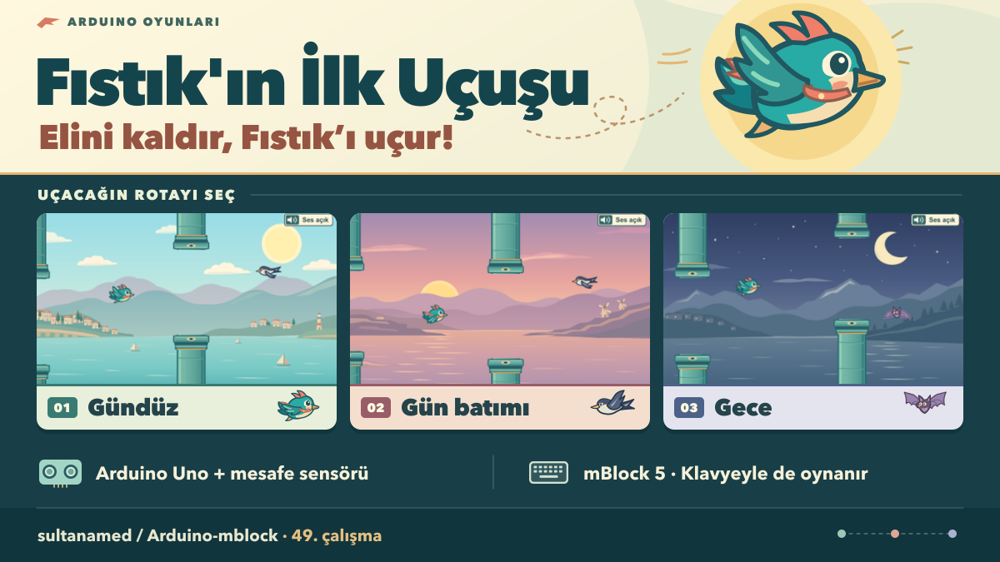
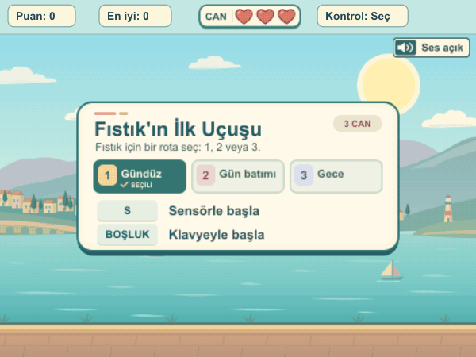
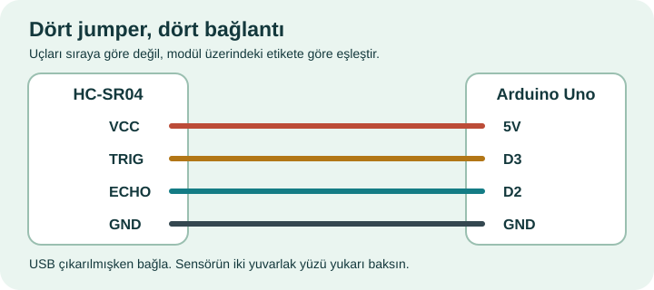

# Fıstık'ın İlk Uçuşu — Mesafe Sensörlü Kuş Oyunu

**[Öğrenci paketini indir (ZIP)](Fistikin_Ilk_Ucusu_Ogrenci_Paketi.zip?raw=true)** · [Yalnızca mBlock projesini indir](Fistikin_Ilk_Ucusu.mblock?raw=true)

**Fıstık adlı kuşu kemerlerin arasından uçur: avucunu kaldırınca yükselir, indirince alçalır.** Bu mBlock dersinde Arduino Uno ve HC-SR04 ile ölçtüğün mesafenin ekranda nasıl harekete dönüştüğünü görebilirsin. Gündüz, gün batımı ve gece rotalarında üç canın var. Her kemerden geçiş bir puan kazandırır. Kartın yoksa aynı oyunu klavyeyle oynayabilirsin.

## Klavyeyle başla

1. ZIP’i bir klasöre çıkar. [mBlock 5 masaüstü uygulamasında](https://mblock.cc/pages/downloads) **Dosya → Bilgisayarınızdan aç** ile ZIP içindeki `Fıstık'ın İlk Uçuşu.mblock` dosyasını aç. Yalnızca projeyi indirdiysen `Fistikin_Ilk_Ucusu.mblock` dosyasını seç.
2. **Yeşil bayrağa** tıkla. **1 / 2 / 3** ile veya ekrandaki rota kutusuna tıklayarak bölüm seç, ardından **Boşluk** tuşuna bas. Her kanat çırpışı için tuşu bırakıp tekrar bas.
3. **Üç canla** başlarsın. Kemere, zemine, üst sınıra veya karşıdan gelen bir hayvana çarpınca bir kalp söner. Üçüncü çarpışmada tur biter. Yeni tur için **Boşluk**, sensörle başlamak için **S**.

| Bölüm | Rotada ne var? |
| --- | --- |
| **1 · Gündüz** | Kıyı boyunca sakin başlar. İlerleyince karşıdan kuşlar gelir. |
| **2 · Gün batımı** | Daha hızlı başlar; kuşlarla daha erken karşılaşırsın. |
| **3 · Gece** | En hızlı rotadır. Kuşların yanında, daha yavaş uçan yarasalara da rastlarsın. |

**Her üç bölümde de puan arttıkça geçitler hızlanır; her rotanın bir üst hız sınırı vardır.** Bitişte 1, 2 veya 3 ile yeni rota seçebilirsin. Elini sensöre yaklaştırmak kuşu alçaltır; geçitlerin hızı puana bağlıdır.

**Sesler:** Elin belirgin bir harekete başladığında veya klavyede yeni bir kanat vuruşu yaptığında **Kanat** sesi çalar. Kemerden geçişte iki notalı **Puan** zili, her can kaybında **Çarpma** sesi duyulur. Son canını kaybettiğinde çarpmayı **Düşüş** ıslığı ve **Bitiş** vuruşu izler. Beş efekt de oyuna gömülüdür. Sağ üstteki **Ses açık / Ses kapalı** düğmesi veya **M** sesleri açıp kapatır. Sesler bilgisayardan gelir; GIF önizlemesi sessizdir.

Ses performansı: [Josh Harmon (@joshplaysdrums) · TikTok](https://www.tiktok.com/@joshplaysdrums/video/7044276412471266607). Sesleri oyundan ayrı incelemek istersen [beş efektin WAV paketini indir](./sesler/Bes_Efekt_WAV.zip?raw=true) veya [ses klasörünü aç](./sesler/). Oyunu çalıştırmak için bu indirme gerekmez.

## Sensörle oyna

Bağlantıları yaparken Uno’nun USB kablosunu çıkar. **Dört pinli HC-SR04** modülündeki yazıları izleyerek dört jumper’ı bağla:

| HC-SR04 | Arduino Uno |
| --- | --- |
| VCC | 5V |
| GND | GND |
| TRIG | D3 |
| ECHO | D2 |

**A0, A1 ve D11** joystick için ayrılmıştır; bu sensör onları kullanmaz.

1. Sensörün iki yuvarlak yüzü yukarı bakacak şekilde yerleştir. Uno’yu USB **veri** kablosuyla bilgisayara bağla.
2. mBlock’ta **Aygıtlar → Arduino Uno → Yükle** modunu seç. **Bağlan** ile doğru USB/COM portunu seç. Projedeki **Upload Mode Broadcast** uzantılarının yüklenmesini bekle; ilk kurulum internet isteyebilir.
3. Uno seçiliyken **Yükle** düğmesine bas ve başarı mesajını bekle. Bu işlem karttaki önceki programı değiştirir. Program kartta kaldığı sürece **her turda yeniden yükleme gerekmez**. USB bağlı, mBlock Yükle modunda kalsın.
4. **Yeşil bayrak → 1, 2 veya 3 → S** ile başlat. Avucunu sensörün yaklaşık **6–32 cm** üzerinde düz tut. Ölçüm gelmezse oyun bekler; **Boşluk** ile klavyeye geçebilirsin.

**Ani ölçümleri gözlemek için:** `D` ile ham ve süzülmüş mesafeleri açıp kapatın. Oyun son üç geçerli örneğin ortancasını kullanır; tek aykırı ölçüm kuşu zıplatmaz.

**Öğretmen notu:** Öğrencilerden 6–32 cm aralığının ortasını bulmalarını ve ellerini bu yükseklikte tutunca kuşun nerede duracağını tahmin etmelerini isteyin.

Sınıfınızla paylaşmak için: [Afişi indir (PNG)](tanitim/Fistikin_Ilk_Ucusu_Afis.png?raw=true) · [Tanıtım videosunu indir (MP4)](tanitim/Fistikin_Ilk_Ucusu_Tanitim.mp4?raw=true) · [Kısa paylaşım metinleri](tanitim/Paylasim_Metni.txt)

**Donanım denemesi:** Arduino Uno ve HC-SR04 ile D3/D2 üzerinden 416 gerçek ölçüm kaydedildi. Üç bölümlü sürüm mBlock 5.6 masaüstünde bağlı Uno ile oynandı. Ham mesafe ve süzülmüş el yüksekliği ekranda değişirken puan 5’ten 7’ye çıktı. Kendi düzeneğinizde aynı kontrolü **D** ile yapabilirsiniz.
