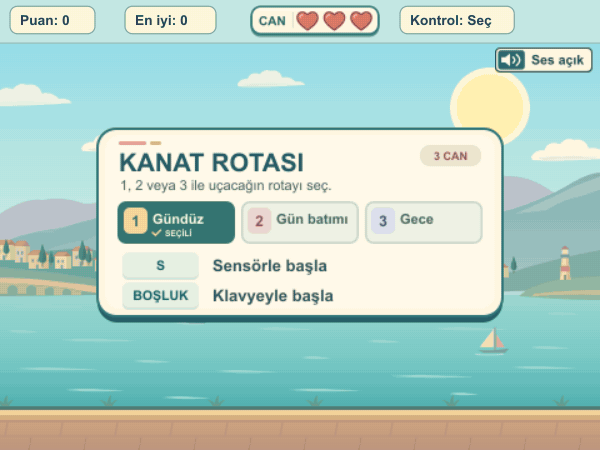
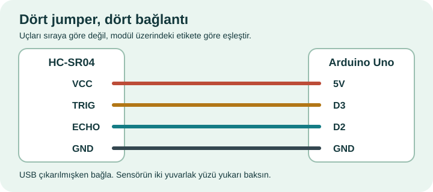

# Kanat Rotası — Mesafe Sensörlü Flappy Bird

**[Öğrenci paketini indir (ZIP)](Kanat_Rotasi_Ogrenci_Paketi.zip?raw=true)** · [Yalnızca mBlock projesini indir](Kanat_Rotasi.mblock?raw=true)

Kuşu kıyıdaki kemerlerin arasından geçir. Arduino Uno ve HC-SR04 mesafe sensörüyle **elini yükseltince kuş yükselir, indirince alçalır**. Kart olmadan klavyeyle de oynayabilirsin.

## Klavyeyle başla

1. ZIP’i bir klasöre çıkar. [mBlock 5 masaüstü uygulamasında](https://mblock.cc/pages/downloads) **Dosya → Bilgisayarınızdan aç** ile `Kanat_Rotasi.mblock` dosyasını seç.
2. **Yeşil bayrağa** tıkla, ardından **Boşluk** tuşuna bas. Her kanat çırpışı için tuşu bırakıp tekrar bas.
3. **Üç canla** başlarsın. Kemere, zemine veya üst sınıra çarpınca bir kalp söner. Üçüncü çarpışmada tur biter. Yeni tur için **Boşluk**, sensörle başlamak için **S**.

**Ses:** Uçuşta yumuşak kanat hışırtısı, çarpışmada kısa bir vuruş bilgisayardan duyulur. **M** ile sesleri kapatıp açabilirsin. Arduino’ya hoparlör bağlamak gerekmez; GIF önizlemesi sessizdir.

## Sensörle oyna

Bağlantıları yaparken Uno’nun USB kablosunu çıkar. **Dört pinli HC-SR04** modülündeki yazıları izleyerek dört jumper’ı bağla:

| HC-SR04 | Arduino Uno |
| --- | --- |
| VCC | 5V |
| GND | GND |
| TRIG | D3 |
| ECHO | D2 |

**A0, A1 ve D11** joystick için ayrılmıştır; bu sensör onları kullanmaz.

1. Sensörün iki yuvarlak yüzü yukarı bakacak şekilde yerleştir. Uno’yu USB **veri** kablosuyla bilgisayara bağla.
2. mBlock’ta **Aygıtlar → Arduino Uno → Yükle** modunu seç. **Bağlan** ile doğru USB/COM portunu seç. Projedeki **Upload Mode Broadcast** uzantılarının yüklenmesini bekle; ilk kurulum internet isteyebilir.
3. Uno seçiliyken **Yükle** düğmesine bas ve başarı mesajını bekle. Bu işlem karttaki önceki programı değiştirir. Program kartta kaldığı sürece **her turda yeniden yükleme gerekmez**. USB bağlı, mBlock Yükle modunda kalsın.
4. **Yeşil bayrak → S** ile başlat. Avucunu sensörün yaklaşık **6–32 cm** üzerinde düz tut. Ölçüm gelmezse oyun bekler; **Boşluk** ile klavyeye geçebilirsin.

**Ani ölçümleri gözlemek için:** `D` ile ham ve süzülmüş mesafeleri açıp kapatın. Oyun son üç geçerli örneğin ortancasını kullanır; tek aykırı ölçüm kuşu zıplatmaz.

**Öğretmen notu:** Öğrencilerden 6–32 cm aralığının ortasını bulmalarını ve ellerini bu yükseklikte tutunca kuşun nerede duracağını tahmin etmelerini isteyin.

**Donanım denemesi:** Arduino Uno ve HC-SR04 ile D3/D2 üzerinden 416 gerçek ölçüm kaydedildi. mBlock 5.6 masaüstünde sensör modunda ham mesafe ve süzülmüş el yüksekliği ekranda değişti; kuşla puan alındı. Kendi düzeneğinizde aynı kontrolü **D** ile yapabilirsiniz.
